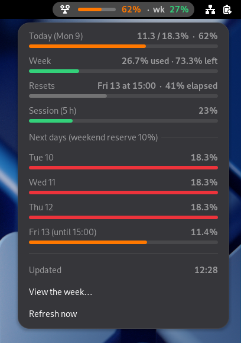
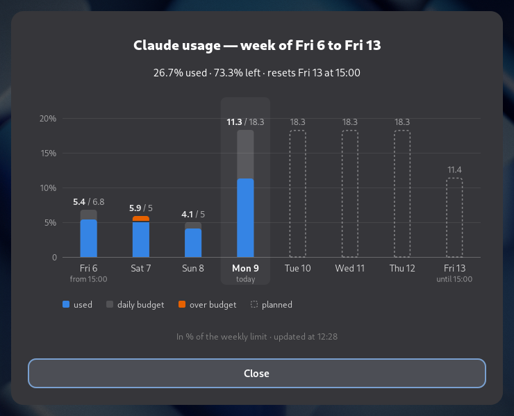
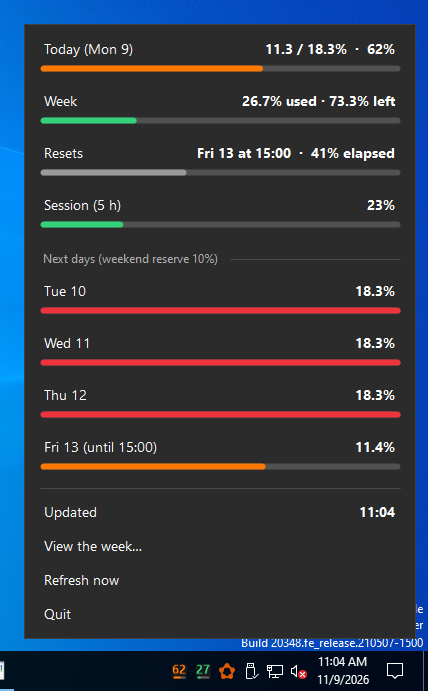
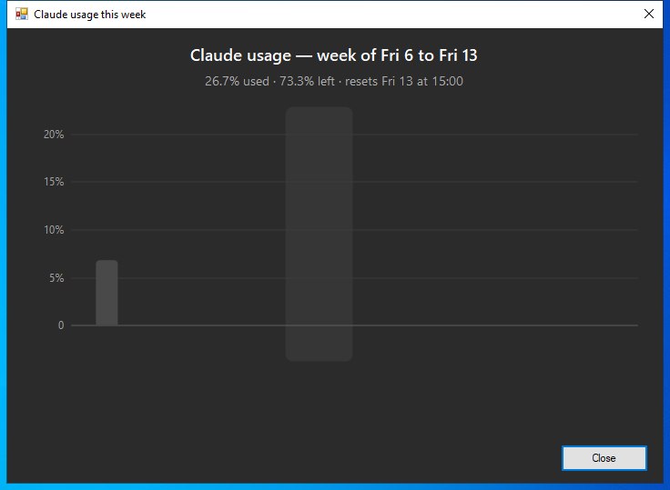

# Claude Budget Widget

**See how much of your weekly Claude limit you can spend today, right next to the clock, on Linux (GNOME) and Windows.**

Claude subscriptions come with a weekly usage limit. Spend it all on Monday and Friday is empty. This widget turns the weekly limit into a **daily budget** and keeps it in view all day:

- **Today**: how much of today's budget you have used (`62%`).
- **Week**: how much of the weekly limit you have used (`27%`).
- **Colors**: green below 50%, orange from 50%, red from 75%.
- **Notifications** at 25, 50, 75 and 100% of today's budget, and again if you go over.
- **A week chart**: usage per day compared with each day's budget.

## Screenshots

The screenshots use sample data.

### Linux (GNOME Shell 48)

Top bar: today's budget as a bar and a percentage, then the week (`wk`).


<table>
  <tr>
    <td valign="top"></td>
    <td valign="top"></td>
  </tr>
</table>

### Windows 10 / 11

Two icons in the notification area, next to Wi-Fi, sound and battery. The left one shows today's budget and the right one shows the week. Each has a small progress bar. Hover for details, left-click for the panel, right-click for the menu.


<table>
  <tr>
    <td valign="top"></td>
    <td valign="top"></td>
  </tr>
</table>

The Windows screenshots are taken automatically by the [CI](.github/workflows/tests.yml) on a GitHub Actions Windows runner. That runner is a Windows Server 2022 machine with a Windows 10-style taskbar.

## How the daily budget works

- **10% of the week is kept for the weekend**: 5% for Saturday and 5% for Sunday.
- **The rest is shared evenly across the weekdays left before the reset.** A reset day only counts the hours inside the quota week.
- **Today's budget is fixed in the morning**, from your usage at the start of the day.
- **The next days are recalculated as you go.** Going over today lowers their share. Unused budget is shared out again the next day.
- **The week follows Claude's own reset time**, read from your account, e.g. Tuesday 15:00.

## Requirements

- **Claude Code**, signed in with a Claude subscription (Pro, Max, Team…). The widget reads the login that Claude Code saves in `~/.claude/.credentials.json`. On Windows that is `%USERPROFILE%\.claude\.credentials.json`.
- **Linux**: GNOME Shell 48 (Wayland or X11).
- **Windows**: Windows 10 or 11. It uses the built-in Windows PowerShell 5.1, so there is nothing else to install.

## Install

### Linux (GNOME)

```sh
git clone https://github.com/MisaShelby/usage-claude-widget.git
cd usage-claude-widget
./install.sh
```

Then log out and back in. GNOME on Wayland only loads new extensions at login. To remove it:

```sh
gnome-extensions uninstall claude-budget@misashelby
```

### Windows

1. Download the project: **Code → Download ZIP** on GitHub, then unzip it. Or use `git clone https://github.com/MisaShelby/usage-claude-widget.git`.
2. Open PowerShell in the project folder and run:

   ```powershell
   powershell -NoProfile -ExecutionPolicy Bypass -File .\windows\install.ps1
   ```

   This copies the widget to `%LOCALAPPDATA%\ClaudeBudget\app`. It also makes the widget start with Windows, adds it to the Start menu and starts it now. No administrator rights are needed.
3. **Windows 11**: new tray icons start in the hidden overflow (`^`). Go to **Settings → Personalization → Taskbar → Other system tray icons** and turn on both **Windows PowerShell** entries. They then stay next to the clock.

To try it without your account, run `powershell -ExecutionPolicy Bypass -File .\windows\ClaudeBudget.ps1 -Demo`. To remove it, run `.\windows\uninstall.ps1`, adding `-KeepHistory` to keep your day-by-day history.

## Where the numbers come from

1. Every 5 minutes, the widget asks Anthropic for your usage. It calls `https://api.anthropic.com/api/oauth/usage` with the login token Claude Code already saved on your computer. This is the same data that `claude /usage` shows.
2. Claude Code renews that token only while it runs. So if the token has expired, or Anthropic refuses the request, the widget runs `claude -p /usage` in the background instead. Claude Code renews its login itself and prints the weekly percentage. This **makes no model request and uses none of your quota**. The menu then says *Updated (via claude /usage)*.

**Privacy**:
- Your token never leaves your computer, except in that request to `api.anthropic.com`.
- Nothing is sent anywhere else.
- The day-by-day history is stored locally, in `~/.local/state/claude-budget/state.json` on Linux and `%LOCALAPPDATA%\ClaudeBudget\state.json` on Windows.

> The usage endpoint is not a documented public API. If Anthropic changes it, the widget falls back on `claude /usage`.

## Language

The widget is in **French or English**, following your system language. Any other language shows English.

## Development

```text
claude-budget@misashelby/   GNOME extension (GJS)
  budget.js                 budget rules, no GNOME import: tested with node
  strings.js                French and English texts
  extension.js, chart.js    top bar, menu, notifications, week chart (Cairo)
windows/                    Windows widget (PowerShell 5.1 + WinForms)
  BudgetCore.ps1            port of budget.js and strings.js
  ClaudeBudget.ps1          notification area icons, panel, week chart (GDI+)
tests/                      node tests and shared reference cases (vectors.json)
tools/screenshots/          README screenshots of the GNOME version
```

- `npm test` runs the tests of the budget rules, the `/usage` parser and the texts. They run in the `Europe/Paris` time zone.
- The Windows port must give **exactly the same results** as the GNOME version. `tests/make-vectors.js` computes 110 reference cases with `budget.js` (`npm run vectors`). The CI checks them on Windows PowerShell 5.1 (`windows/tests/Run-Tests.ps1`), and `npm test` fails if `vectors.json` is out of date.
- Screenshots:
  - Linux: `tools/screenshots/linux.sh` takes them in a headless GNOME Shell.
  - Windows: the CI takes them when a commit message contains `[screenshots]`.

## Credits

The `claude /usage` fallback is inspired by the [weekly-budget](https://github.com/Fafafa12/claude-weekly-budget) Claude Code plugin (MIT).

This project is not affiliated with or endorsed by Anthropic. *Claude* is a trademark of Anthropic.

## License

[MIT](LICENSE)
